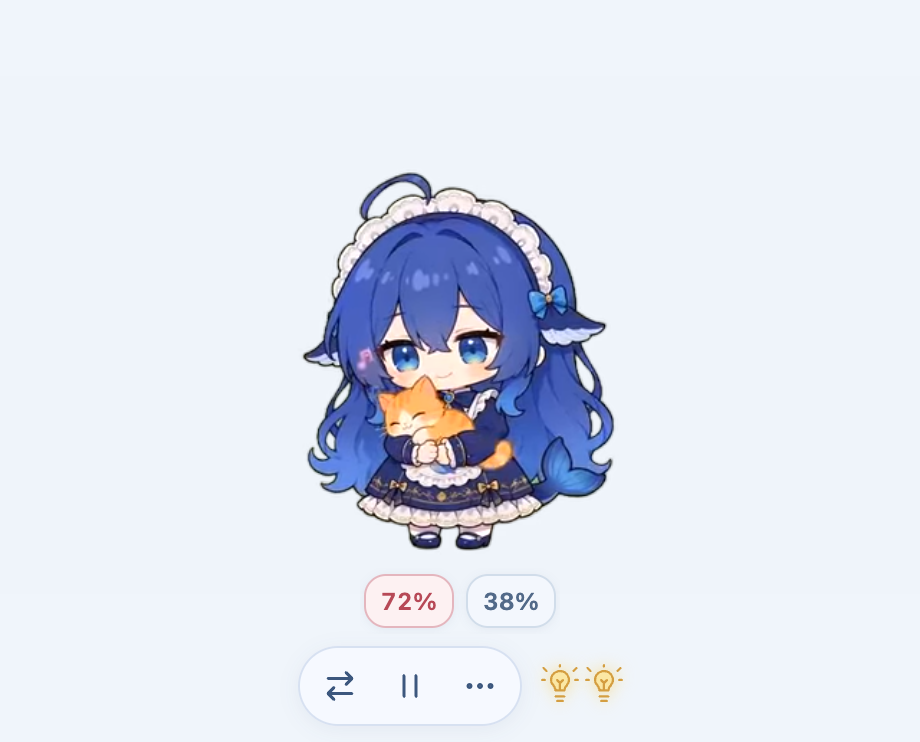

<div align="center">

# 🐋 DaFeiYu-magpie

### 蓝色大肥鱼 · 让 Magpie 的工作状态变成桌边的陪伴

**A macOS desktop pet for Magpie — live request lights, multi-account quotas, and 106 animations.**




*截图使用演示账号和数值。角色与动画来自 [PC2005-cloud/dsh-pet](https://github.com/PC2005-cloud/dsh-pet)。*

[快速开始](#快速开始) · [功能](#功能) · [接入范围](#接入范围) · [致谢](#致谢与贡献来源) · [English](#english)

</div>

DaFeiYu-magpie 是一个为 **macOS + Magpie** 制作的独立桌宠：大肥鱼会在桌边玩耍、施法、放烟花；旁边的小灯泡告诉你有几个请求正在进行，账号百分比告诉你还剩多少额度。

不需要安装 DeepSeek Harness，也不依赖 Codex 客户端。只要请求经过本机 [Magpie](https://github.com/yetone/magpie)，无论来自哪个受支持的客户端，都可以通过网关状态参与联动。

## 功能

| 功能 | 效果 |
| --- | --- |
| 106 段透明动画 | 鲜亮蓝配色，吃饭、玩耍、烟花、魔术、小节目随时点播 |
| 减少重复 | 随机节目避开最近 15 个；呼吸待机抽取概率 15%，不连续播放 |
| 工作陪伴 | 每两段工作状态动画穿插一个小动作；普通状态变化等当前动画播完再切换 |
| 请求灯泡 | 几个进行中的请求亮几盏（含排队），空闲熄灭，断连变淡 |
| 多账号额度 | 每个账号只显示一个百分比；多个窗口取最低值；未知或过期显示 `—%` |
| 使用中的账号标红 | 根据当前请求的实际路由匹配账号；珊瑚红表示正在使用，其他账号为灰蓝色 |
| 横排额度栏 | 放在按钮上方；账号多时可左右滑动或用滚轮查看 |
| 简单控制 | **⇄ 换动作**、**Ⅱ / ▶ 暂停或继续**、**••• 更多**；暂停时换动作仍保持暂停 |
| 桌面互动 | 拖动、甩动弹跳、透明区域鼠标穿透；可贴近左右边缘，允许部分动画越出屏幕 |
| 菜单栏找回 | 🐋 →「回到屏幕内」、隐藏、锁定位置、调整大小和退出 |

额度与设置、全部动作点播在 **•••** 菜单中。默认不开机启动。

## 快速开始

### 环境

- **Apple Silicon Mac（arm64）**，当前构建目标为 macOS；未验证 Intel Mac、Windows 或 Linux。
- **Node.js 24+、npm、Python 3**，以及 Git。
- [Magpie](https://github.com/yetone/magpie) 已在本机启动。联动在 Magpie `0.1.1349` 上验证；接口变化可能需要更新适配器。
- 首次安装需要联网下载 npm 依赖、Electron 和约 52 MB 动画素材。

### 从源码运行

```bash
git clone https://github.com/wolfvoid/DaFeiYu-magpie.git
cd DaFeiYu-magpie
npm ci --ignore-scripts
node node_modules/electron/install.js
python3 scripts/download_assets.py
node scripts/prepare.mjs
npm run build
npm test
npm start
```

动画从上游固定提交下载，逐个校验大小与 Git blob SHA-1；不会把整套视频重复放进本仓库。Magpie 未启动时仍可播放桌宠，状态与额度显示不可用。

### 构建 Mac 应用

```bash
npm run package
```

生成 `dist/蓝色大肥鱼-darwin-arm64/蓝色大肥鱼.app`，可拖入「应用程序」后打开。当前是源码自建版本，**没有 Apple Developer ID 签名或公证**；请按 macOS 的正常安全提示确认来源。本项目不提供关闭 Gatekeeper 的脚本。

> 当前发布以源码为主。不要把 GitHub 的 “Source code.zip” 当作可直接打开的 `.app`。

## 接入范围

**它显示 Magpie 能看见的请求，不代表完整任务追踪。**

- 能知道：有几个请求、是否排队、网关可见的工具等待状态、当前请求实际使用的账号、Magpie 已缓存的额度。
- 不能知道：具体改了哪个文件、正在运行哪条本地命令、是否等待用户审批，以及整个任务是否完成。
- 不经过本机 Magpie 的请求不可见；不会把一次模型响应结束误判为整个任务完成，也不会因此自动放烟花。
- 标红只依据仍在进行的上游请求及其未结束的路由尝试；排队、已结束或账号无法确认时不标红。多个账号同时处理请求时可以一起标红。
- Magpie 未返回额度的账号不能凭空推算；每个账号的显示百分比取其额度窗口最低剩余值，不表示还能提问多少次。

### 本地只读接口

| 数据 | 接口 | 频率 |
| --- | --- | --- |
| 请求状态 | `GET /v1/magpie/concurrency` | 每 2 秒 |
| 账号归属 | `GET /v1/magpie/trace?after=…` | 有上游请求时增量读取 |
| 额度快照 | `GET /v1/magpie/quotas/cards` | 每 30 秒 |
| 今日统计 | `GET /v1/magpie/usage?period=today` | 每 30 秒 |

仅连接 `127.0.0.1`，默认端口 `3425`；自定义端口从 `$XDG_CONFIG_HOME/magpie/settings.json`（默认 `~/.config/magpie/settings.json`）只读获取。额度使用 Magpie 缓存，超过 10 分钟或窗口已重置时显示待刷新；需要在 Magpie 中更新源数据。

## 隐私与本地设置

- 不调用模型、不主动聊天，不消耗额外推理额度；不修改 Magpie 的账户、模型或路由配置。
- 不读取 Codex 数据库，不启动 Codex app-server；无遥测，无额外监听端口。
- 不展示或保存账号邮箱、会话、提示词或聊天正文。路由响应只用于提取账号归属；缓存与界面使用每次启动重新生成的加盐账号代号。
- 额度提示只展示套餐与序号，不展示邮箱。README 截图为独立演示数据。
- 位置与偏好保存在 `~/Library/Application Support/BlueDaFeiYu-Codex/settings.json`。目录名保留早期版本的兼容性，当前联动来源是 Magpie。
- 菜单栏退出后，删除 `.app` 即可卸载；设置可自行保留或删除。

## 开发与验证

```bash
npm test                    # 调度、去重、账号匹配、额度和屏幕边界测试
npm run check               # 106 个素材校验和 + 本机状态读取
node scripts/check.mjs --quota
npm start -- --smoke-test    # 实际界面、暂停/继续、灯泡、横排滚动与越界测试
```

界面检查需要 macOS 图形会话，并会暂时操作桌宠、保存本地 `qa/` 报告。报告、用户配置、依赖、动画下载文件和构建产物均不提交到 Git。

核心文件：`src/magpie.mjs`（只读适配）、`src/animation.mjs`（动画调度）、`src/quota-display.mjs`（账号百分比）、`src/pet.*`（桌宠界面）、`src/main.cjs`（Mac 窗口与菜单）。

欢迎通过 Issue 提交兼容性问题，或通过 PR 改进。请先阅读 [CONTRIBUTING.md](CONTRIBUTING.md)，不要附带真实账号、密钥或原始路由日志。

## 致谢与贡献来源

这个项目建立在以下作者的工作之上。**上游作者并不因此被声明为本仓库的直接提交者或背书者。**

| 项目 / 作者 | 本项目中的来源与作用 |
| --- | --- |
| **[PC2005-cloud/dsh-pet](https://github.com/PC2005-cloud/dsh-pet)** | 大肥鱼形象、106 段动画、动作配置与初始选择器。动画固定于 `242fac13053ca6d7a5d316124df499013c2494a1`；保留 MIT 文本与素材使用说明。是最重要的视觉与动画来源。 |
| **[yetone/magpie](https://github.com/yetone/magpie)** | 本地模型网关，以及额度、并发、路由接口与集成文档。桌宠通过只读接口联动，不修改或打包 Magpie。 |
| **[yifanlu0227/DaFeiYu-codex-pet](https://github.com/yifanlu0227/DaFeiYu-codex-pet)** | 最初的大肥鱼桌宠与 Codex 宠物安装思路参考；本项目没有使用其 spritesheet，也不是其安装器。 |
| **[bianbian-666/Codex-dafeiyu](https://github.com/bianbian-666/Codex-dafeiyu)** | 早期 Codex 状态联动方案参考；当前版本已移除 Codex 适配，改为 Magpie。 |
| **[Electron](https://github.com/electron/electron)** | macOS 透明置顶窗口、视频渲染与桌面交互运行时。 |

本仓库新增的是 macOS 独立应用整合、Magpie 只读适配、多账号额度与请求灯泡、工作/待机调度、交互与界面。完整来源说明见 [THIRD_PARTY_NOTICES.md](THIRD_PARTY_NOTICES.md)。

## 许可

- 本仓库新增代码采用 [MIT](LICENSE)；上游选择器保留其 [MIT 许可](licenses/dsh-pet-MIT.txt)。
- **角色动画、提示词、源视频等素材不属于 MIT 授权范围**。上游允许开源使用、**禁止商用**，衍生作品的介绍、展示和分发必须附原作者地址：[PC2005-cloud/dsh-pet](https://github.com/PC2005-cloud/dsh-pet)。README 展示图同样包含这些素材。
- 下载器仅提供取得上游素材的可复现路径，不改变素材授权。请在分发二创或打包应用时保留来源与许可说明。
- 独立社区项目，与 DeepSeek、OpenAI、Magpie 无官方隶属或合作关系；不声称是首个或唯一的同类项目。

## English

**DaFeiYu-magpie** is an independent **macOS desktop pet for Magpie**, featuring the blue DaFeiYu character, 106 transparent animations, per-request light bulbs, and a horizontal multi-account quota strip. Active accounts turn coral red; other accounts stay slate blue. Each account displays one remaining percentage, using its most constrained quota window.

It reads only the local Magpie gateway. It does not submit inference requests, change routing, or require DSH/Codex to run. Request activity is not full agent-task awareness. Build from source on an Apple Silicon Mac with Node.js 24+, Python 3, and the commands above. The app is currently unsigned and not notarized.

**Credits:** character, animation assets, configuration and initial picker code by [PC2005-cloud/dsh-pet](https://github.com/PC2005-cloud/dsh-pet); gateway integration by [yetone/magpie](https://github.com/yetone/magpie). New code is MIT; upstream artwork is **noncommercial and requires attribution**, including in derived screenshots and distributions.
